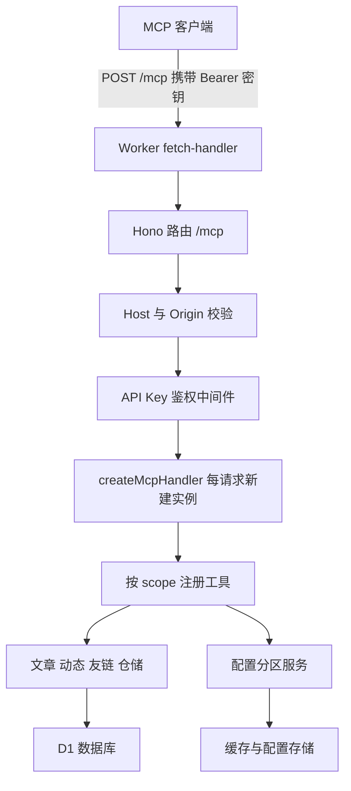

# Rin 博客 MCP 服务技术设计

Feature Name: mcp-service
Updated: 2026-10-25

## Description

Rin 博客在站点根路径 `/mcp` 暴露 MCP（Model Context Protocol）服务端。服务端使用 MCP TypeScript SDK v2 的无状态 Streamable HTTP 处理器，鉴权复用站点既有的 32 位 API Key 体系，工具集合按密钥权限（scope）动态裁剪。

实现要点：

- 依赖 `@modelcontextprotocol/server@^2.4.0`（SDK v2，实现 MCP 2026-07-28 规范，含 `workerd` 导出条件）与 `zod@^4.6.7`（输入参数 Schema）。
- 每个 HTTP 请求创建独立的 `McpServer` 实例，工具注册逻辑按当前密钥的 scope 集合裁剪。
- 鉴权复用 `apiKeyAuthMiddleware`，因此密钥的哈希校验、`last_used_at` 刷新、scope 解析行为与 REST API 完全一致。
- 端点位于 `/mcp`（非 `/api/mcp`），需要在 Worker 入口把该路径路由到 Hono 应用，避免落入单页应用回退。

## Architecture



请求处理顺序与既有 REST API 的差异点：

1. Worker 入口识别 `/mcp` 前缀并转发到 Hono 应用（其余路径行为不变）。
2. Hono 全局中间件注入 `db`、`cache`、`serverConfig`、`clientConfig`、`env`。
3. `/mcp` 路由先执行 Host/Origin 校验，再执行 API Key 鉴权。
4. 鉴权通过后按请求创建 `createMcpHandler` 实例，工厂闭包捕获本次请求的上下文与 scope 集合。
5. SDK 在工厂中创建 `McpServer`，按 scope 注册工具，随后处理 JSON-RPC 消息。

## Components and Interfaces

### `server/src/features/mcp/guard.ts`

| 导出 | 签名 | 说明 |
| --- | --- | --- |
| `resolveAllowedHosts` | `(env: Env, request: Request) => string[]` | 允许列表 = `FRONTEND_URL` 主机名 + localhost 主机名；`FRONTEND_URL` 缺失时回退为请求自身主机名。 |
| `guardMcpRequest` | `(request: Request, env: Env) => Response \| null` | 调用 SDK 的 `hostHeaderValidationResponse` 与 `originValidationResponse`，命中拒绝条件时返回 403 响应，否则返回 `null`。 |

### `server/src/features/mcp/tools.ts`

工具定义表 `MCP_TOOL_DEFINITIONS`，每项包含工具名、所需 scope、中文描述、输入 Schema 与执行函数：

| 工具 | 所需权限 | 输入参数 | 说明 |
| --- | --- | --- | --- |
| `whoami` | 无（鉴权即拥有） | 无 | 返回密钥标识、权限清单与可用工具清单 |
| `list_posts` | `content.read` | `page`、`limit`、`type` | 分页文章列表，`limit` 上限 50 |
| `get_post` | `content.read` | `id` 或 `alias` | 文章详情 |
| `search_posts` | `content.read` | `keyword`、`page`、`limit` | 标题关键词搜索 |
| `list_tags` | `content.read` | 无 | 标签及关联文章数 |
| `list_moments` | `content.read` | `page`、`limit` | 动态列表 |
| `list_friends` | `content.read` | `page`、`limit` | 友链列表 |
| `create_post` | `feed.write` | `title`、`content`、`alias`、`summary`、`tags`、`listed`、`draft`、`createdAt` | 发布文章 |
| `update_post` | `feed.write` | `id` 与可选字段 | 修改文章 |
| `delete_post` | `feed.write` | `id` | 删除文章 |
| `create_moment` | `moment.write` | `content` | 发布动态 |
| `update_moment` | `moment.write` | `id`、`content` | 修改动态 |
| `delete_moment` | `moment.write` | `id` | 删除动态 |
| `create_friend` | `friend.write` | `name`、`desc`、`avatar`、`url`、`group`、`accepted`、`sort_order` | 创建友链 |
| `update_friend` | `friend.write` | `id` 与可选字段 | 修改友链 |
| `delete_friend` | `friend.write` | `id` | 删除友链 |
| `get_config` | 该分区 scope | `section` | 读取配置分区 |
| `update_config` | 该分区 scope | `section`、`values` | 写入配置分区 |

配置工具的 scope 是动态的：`get_config` 与 `update_config` 在密钥持有任意 `config.*` 权限时注册，调用时按分区解析出实际 scope 并二次校验，缺失时返回指明权限名的错误。

### `server/src/features/mcp/server.ts`

```ts
export interface McpServerDeps {
    db: DB;
    cache: CacheImpl;
    serverConfig: CacheImpl;
    clientConfig: CacheImpl;
    env: Env;
    scopes: string[];
    keyId: number;
    uid: number;
}

export function createRinMcpServer(deps: McpServerDeps): McpServer
```

内部流程：创建 `McpServer({ name: "rin-blog", version: "1.0.0" })`，遍历 `MCP_TOOL_DEFINITIONS`，按 `deps.scopes` 过滤后调用 `server.registerTool(name, { description, inputSchema }, handler)`。执行函数通过闭包访问 `deps`，读写逻辑复用现有仓储与缓存清理函数。

### `server/src/services/mcp.ts`

```ts
export function McpService(): Hono
```

- `app.use("*", apiKeyAuthMiddleware())`：复用既有鉴权中间件，缺失密钥返回 401 `Missing API key`，无效密钥返回 401 `Invalid API key`。
- `app.all("/", handler)`：先做 Host/Origin 校验，再创建 `createMcpHandler` 并调用 `handler.fetch(c.req.raw, { authInfo })`。
- `authInfo` 结构：`{ clientId: "api-key:<id>", scopes, extra: { props: { uid, keyId, scopes } } }`，不携带密钥明文。

### 修改点

| 文件 | 修改内容 |
| --- | --- |
| `server/src/core/register-routes.ts` | 注册 `app.route("/mcp", McpService())` |
| `server/src/runtime/fetch-handler.ts` | 新增 `/mcp` 路径模式，命中时转发到 Hono 应用而非单页应用回退 |
| `server/src/utils/api-key-scopes.ts` | 新增 `content.read` 权限（标题「内容读取」），设置页权限目录与 `/api/key/manage/scopes` 自动包含该项 |

## Data Models

### 权限与工具映射

`MCP_TOOL_DEFINITIONS` 使用以下结构描述一项工具：

```ts
interface McpToolDefinition {
    name: string;
    scope?: string;
    scopes?: string[];
    description: string;
    inputSchema: z.ZodObject<z.ZodRawShape>;
    handler: (args: any, deps: McpServerDeps) => Promise<CallToolResult>;
}
```

- `scope` 用于单权限工具；`scopes` 用于「任一权限即可注册」的工具（配置工具）。
- 注册判定：`scope` 命中 `deps.scopes`，或 `scopes` 与 `deps.scopes` 存在交集。

### 鉴权上下文

| 字段 | 类型 | 来源 |
| --- | --- | --- |
| `keyId` | `number` | `api_keys.id` |
| `uid` | `number` | `api_keys.uid` |
| `scopes` | `string[]` | `api_keys.scopes` JSON 数组，经 `JSON.parse` 与字符串过滤 |

### 数据来源

| 数据 | 来源 |
| --- | --- |
| 文章 | `feeds` 表，复用 `findFeedById`、`insertFeed`、`updateFeedById`、`deleteFeedById`、`searchFeedPage` |
| 标签 | `hashtags` 与 `feed_hashtags` 表，复用 `bindTagToPost` |
| 动态 | `moments` 表 |
| 友链 | `friends` 表 |
| 配置 | `clientConfig` 与 `serverConfig` 缓存，沿用 `API_KEY_CONFIG_SECTIONS` 的可写键白名单 |

## Correctness Properties

1. **工具可见性等价于 scope**：某工具出现在 `tools/list` 中，当且仅当当前密钥的 scope 集合满足该工具的权限要求。
2. **权限二次校验**：配置类工具在注册时按「任一 `config.*`」判定，调用时按目标分区的确切 scope 判定，缺失权限时返回错误信息且不产生写操作。
3. **请求隔离**：每个 MCP 请求使用独立的 `McpServer` 实例，请求之间不共享工具状态。
4. **鉴权前置**：所有 `/mcp` 请求在进入 MCP 处理前完成 API Key 校验，鉴权失败时响应中不包含密钥信息。
5. **缓存一致性**：文章写入成功后清理 `feeds_`、`search_` 前缀缓存与文章详情缓存，动态写入成功后清理 `moments_` 前缀缓存。
6. **内容归属**：API Key 创建的文章、动态、友链归属 `uid=1`，与既有 `/api/key/*` 接口保持一致。
7. **路径隔离**：`/mcp` 之外的请求仍走既有 API 路由或单页应用回退逻辑。

## Error Handling

| 场景 | 状态码 | 响应 |
| --- | --- | --- |
| 缺少 API Key | 401 | `{ "success": false, "error": "Missing API key" }` |
| API Key 无效 | 401 | `{ "success": false, "error": "Invalid API key" }` |
| Host 或 Origin 不在允许列表 | 403 | SDK 提供的 403 响应 |
| 权限不足 | JSON-RPC 错误 | 工具返回 `isError` 内容，指明缺失权限名 |
| 参数非法 | JSON-RPC 错误 | 工具返回 `isError` 内容，指明非法字段 |
| 目标不存在 | JSON-RPC 错误 | 工具返回 `isError` 内容，指明资源类型 |
| GET/DELETE 请求 `/mcp` | 405 | SDK 无状态处理器返回 |

工具执行异常统一转换为 `isError` 的文本内容，避免中断 MCP 会话；服务端日志只记录工具名与错误类型，不记录密钥明文。

## Test Strategy

测试位置：`server/src/features/mcp/__tests__/mcp.test.ts`，使用 `bun:test` 与 `server/tests/fixtures` 的 `setupTestApp`。

| 用例 | 断言 |
| --- | --- |
| 缺少密钥访问 `/mcp` | 401 且错误为 `Missing API key` |
| 无效密钥访问 `/mcp` | 401 且错误为 `Invalid API key` |
| `tools/list` 返回按权限裁剪的工具集合 | 仅 `content.read` 密钥看到读取工具，不看到写入工具 |
| `whoami` 返回权限与工具清单 | 包含 `scopes` 与 `tools` 字段 |
| `create_post` 创建文章后返回标识 | 数据库出现新文章且 `uid=1` |
| `update_post` 修改标题 | 数据库内容同步更新 |
| `delete_post` 删除文章 | 文章从数据库移除 |
| `create_moment`、`create_friend` 正常写入 | 对应表新增记录 |
| `update_config` 拒绝不可写键 | 返回错误且配置未变更 |
| `update_config` 拒绝越权分区 | 返回缺失权限名 |
| Host 不匹配时拒绝请求 | 403 |

手工验收：使用 MCP Inspector 以 `https://<站点域名>/mcp` 与 `Authorization: Bearer <key>` 连接，验证 `tools/list` 与 `tools/call`。

## References

[^1]: (server/src/core/api-key-middleware.ts#L21) - API Key 鉴权中间件与 scope 校验
[^2]: (server/src/utils/api-key-scopes.ts#L8) - 权限目录定义
[^3]: (server/src/utils/api-key.ts#L24) - 32 位密钥生成与 SHA-256 哈希
[^4]: (server/src/db/schema.ts#L114) - api_keys 表结构
[^5]: (server/src/core/register-routes.ts#L20) - 路由注册入口
[^6]: (server/src/runtime/fetch-handler.ts#L78) - Worker 请求分发与 `/api` 前缀改写
[^7]: (server/src/features/feed/repository.ts#L8) - 文章仓储函数
[^8]: (server/src/services/api-key-config.ts#L41) - 配置分区读写与可写键校验
[^9]: (server/src/utils/api-key-config-sections.ts#L92) - 配置分区与 scope 映射
[^10]: (server/src/services/clear-feed-cache.ts#L3) - 缓存清理函数
[^11]: (server/src/services/api-key-owner.ts#L1) - API Key 内容属主 uid
[^12]: (https://ts.sdk.modelcontextprotocol.io/v2/serving/http) - MCP SDK v2 HTTP 服务指南
[^13]: (https://ts.sdk.modelcontextprotocol.io/v2/serving/web-standard) - Web 标准运行时挂载与 DNS rebinding 防护
[^14]: (https://developers.cloudflare.com/agents/model-context-protocol/apis/handler-api/) - Cloudflare MCP 处理器 API 参考
