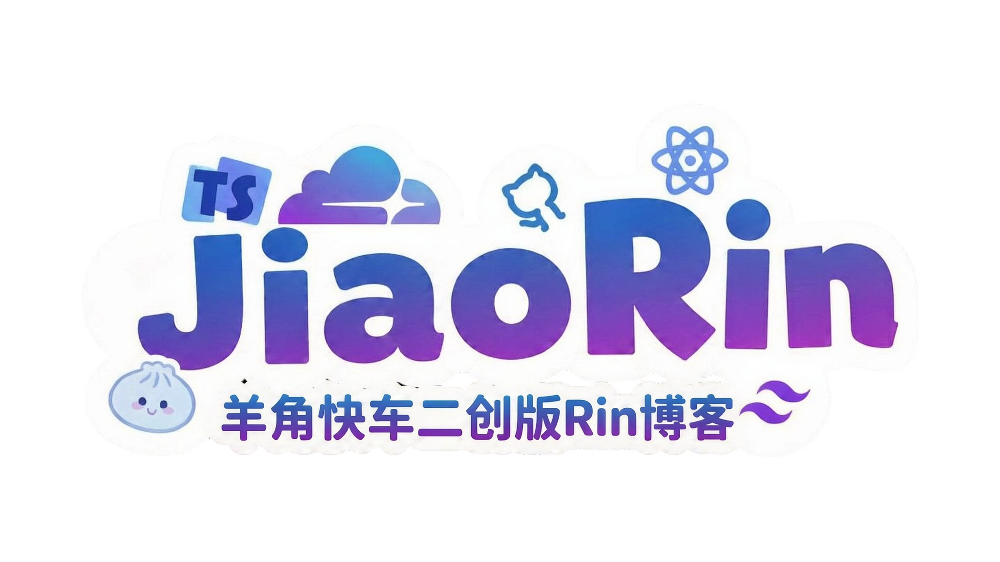

[English](./README.md) | 简体中文

[](https://deepwiki.com/wool-hmq/Rin)


[](https://discord.gg/JWbSTHvAPN)
[](https://t.me/openRin)

## 项目简介

Rin 是一个基于 Cloudflare 开发者平台构建的现代化、无服务器博客系统，完全利用 Cloudflare Workers 提供无服务器函数并托管前端静态资源、D1 作为 SQLite 数据库、R2 进行对象存储。仅需一个指向 Cloudflare 的域名即可部署你的个人博客，无需服务器运维。

## 在线演示

- 本版演示站点：[https://jiaoblog.dpdns.org](https://jiaoblog.dpdns.org)

## 功能特性

- **用户认证与管理**：支持 GitHub OAuth 登录。首个注册用户自动成为管理员，后续用户作为普通成员加入。
- **内容创作**：通过丰富的编辑器撰写和编辑文章。
- **实时自动保存**：本地草稿实时自动保存，不同文章之间互不干扰。
- **隐私控制**：可将文章标记为“仅自己可见”，用作私有草稿或个人笔记，并支持跨设备同步。
- **图片管理**：通过拖放或粘贴上传图片至兼容 S3 的存储（如 Cloudflare R2），并自动生成链接。
- **自定义别名**：为文章设置友好的 URL，例如 `https://yourblog.com/about`。
- **不公开文章**：可选择将文章隐藏于首页列表之外。
- **友情链接**：添加友博客链接，后端每 20 分钟自动检查链接可用性并更新状态。
- **评论系统**：支持回复评论，并具备评论删除管理功能。
- **Webhook 通知**：通过可配置的 Webhook 接收新评论的实时提醒。
- **特色图片**：自动识别文章内首张图片，并将其作为列表页的封面图展示。
- **标签解析**：输入如 `#博客 #Cloudflare` 的标签文本，自动解析并展示为标签。
- **类型安全**：通过 `@rin/api` 包在客户端和服务器之间共享 TypeScript 类型，实现端到端类型安全。
- ……更多功能请访问 https://jiaoblog.dpdns.org 探索。

## 文档

### 快速开始

```bash
# 1. 克隆本仓库（羊角快车二创版，推荐）
git clone https://github.com/wool-hmq/Rin.git && cd Rin

# 官方原版（上游 openRin/Rin，不含本版新增功能，仅供参考）
# git clone https://github.com/openRin/Rin.git && cd Rin

# 2. 安装依赖
bun install

# 3. 配置环境变量
cp .env.example .env.local
# 编辑 .env.local 填入你的配置信息

# 4. 启动开发服务器
bun run dev
```

访问 http://localhost:5173 开始开发！

### 测试

运行测试套件以确保一切正常：

```bash
# 运行所有测试（客户端 + 服务器）
bun run test

# 仅运行服务器测试
bun run test:server

# 运行测试并设置覆盖率
bun run test:coverage
```

### 一键部署

构建前端后会将其作为静态资源随 Worker 一起上传，因此一个 Worker 同时提供 API 与网页：

```bash
# 构建前端、部署 Worker、同步密钥并执行数据库迁移
bun run deploy
```

**必需的环境变量：**

- `CLOUDFLARE_API_TOKEN` - 您的 Cloudflare API 令牌
- `CLOUDFLARE_ACCOUNT_ID` - 您的 Cloudflare 帐户 ID

**可选的环境变量：**

- `WORKER_NAME` - Worker 名称（默认值：`rin-server`）
- `DB_NAME` - D1 数据库名称（默认值：`rin`）
- `R2_BUCKET_NAME` - R2 存储桶名称。设置后，部署会自动推导对应的 `S3_*` 配置；未设置时，不会自动选择任何 bucket。

部署脚本将自动执行以下操作：

- 自动检测并创建 D1 数据库如果不存在
- 仅在显式设置 `R2_BUCKET_NAME` 时，自动推导对应的 `S3_*` 存储配置
- 构建前端并部署单个 Worker，由它同时提供 API 与静态资源
- 运行数据库迁移

### GitHub Actions Workflows

存储库包含多个自动化工作流程：

- **`ci.yml`** - 每次推送/PR 都会运行类型检查和格式验证
- **`test.yml`** - 运行全面的测试（服务器+客户端），并生成覆盖率报告
- **`build.yml`** - 构建项目并触发部署
- **`deploy.yml`** - 部署 Worker，由它同时提供 API 与静态资源

**必备变量 (Repository Settings → Secrets and variables → Actions):**

- `CLOUDFLARE_API_TOKEN` - 您的 Cloudflare API 令牌，包含 Workers 和 D1 权限
- `CLOUDFLARE_ACCOUNT_ID` - 您的 Cloudflare 帐户 ID

**可选配置(Repository Settings → Secrets and variables → Variables):**

- `WORKER_NAME`, `DB_NAME` - 资源名称
- `NAME`, `DESCRIPTION`, `AVATAR` - 站点配置
- `R2_BUCKET_NAME` - 要使用的特定 R2 存储桶

羊角快车二创版 Rin 完整文档请访问 https://rin.lab.j3.ink ，文档源文件位于 [./docs/docs/zh](https://github.com/wool-hmq/Rin/tree/main/docs/docs/zh)。

官方原版文档位于 https://docs.openrin.org。

## 社区与支持

- **本版支持（羊角快车二创版）**：如果你发现了本二创版的 Bug 或有针对新增功能的建议，请在本仓库提交 [Issue](https://github.com/wool-hmq/Rin/issues)。
- **官方原版（openRin/Rin，不提供本版官方支持）**：
  以下链接属于 openRin 原项目，你可以加入以讨论核心平台的基础功能。
  - [上游 Discord 频道](https://discord.gg/JWbSTHvAPN)
  - [上游 Telegram 频道](https://t.me/openRin)
  - [上游 Issues](https://github.com/openRin/Rin/issues)

## Star 历史

<a href="https://www.star-history.com/?repos=wool-hmq%2Frin&type=date&legend=top-left">
 <picture>
   <source media="(prefers-color-scheme: dark)" srcset="https://api.star-history.com/chart?repos=wool-hmq/rin&type=date&theme=dark&legend=top-left" />
   <source media="(prefers-color-scheme: light)" srcset="https://api.star-history.com/chart?repos=wool-hmq/rin&type=date&legend=top-left" />
   
 </picture>
</a>

## 参与贡献

我们欢迎各种形式的贡献——代码、文档、设计和想法。请查阅我们的[贡献指南](https://rin.lab.j3.ink/guide/contribution.html)，一起参与 Rin 的构建！

## License

```
MIT 许可证

版权所有 (c) 2024 Xeu
版权所有 (c) 2026 羊角快车

【非官方中文译文声明】
本文件是 MIT 许可证的非官方中文翻译，仅供方便理解，不具有法律效力。
具有法律约束力的许可证文本以本项目根目录 LICENSE 文件中的英文原文为准。
如本译文与英文原文之间存在任何歧义、遗漏或冲突，均以英文原文为准。
本译文不构成法律意见。

特此授予任何人免费获得本软件及相关文档文件（“本软件”）副本的许可，
包括不受限制地处理本软件的权利，包括但不限于使用、复制、修改、合并、
发布、分发、再许可和/或销售本软件副本的权利，并允许获得本软件的人
这样做，但须满足以下条件：

上述版权声明和本许可声明应包含在本软件的所有副本或实质性部分中。

本软件按“原样”提供，不附带任何明示或暗示的保证，包括但不限于对
适销性、特定用途适用性和非侵权性的保证。在任何情况下，作者或版权
持有人均不对任何索赔、损害或其他责任承担责任，无论是在合同诉讼、
侵权行为还是其他方面，由本软件或本软件的使用或其他交易引起、产生
或与之相关。
```
